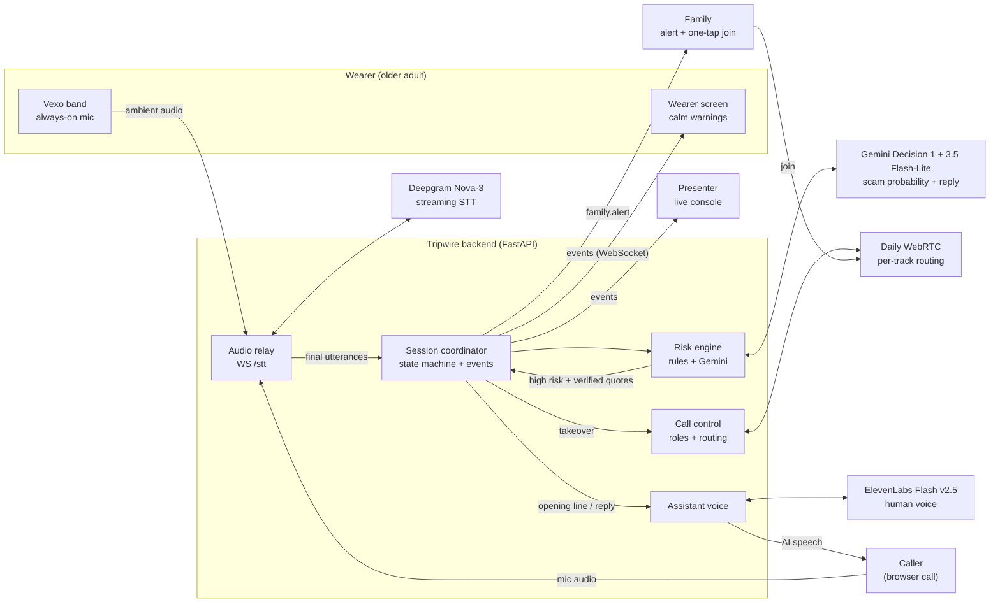

# Tripwire

**A pause when it matters.** Tripwire is an always-on guardian for older adults, built on the **Vexo band**. When someone pressures the wearer ("buy gift cards now, don't tell anyone"), Tripwire notices within a second:
- it pauses the conversation, and an identified AI assistant holds the caller;
- the wearer gets a calm warning;
- a trusted family member is alerted with the **exact words** that raised concern, and can join in one tap.

> Built for Vexo Hacks with **Vexo** · **Deepgram** · **Google DeepMind Gemini** · **ElevenLabs** · **Daily**.
> Why each one is essential, plus the demo scripts and Q&A defences: [`docs/PITCH.md`](docs/PITCH.md).

## Architecture



**State machine:** `monitoring → protecting → assistant_active → family_joined → ended`. Illegal transitions are rejected. Duplicate high-risk decisions never start a second takeover or alert. The takeover is active only when the wearer client has confirmed that caller audio is blocked **and** the assistant is ready.

### How one scam call flows
1. The caller speaks. The browser (or band) streams audio to `WS /ws/sessions/{id}/stt`, and the backend relays it to **Deepgram**. Each finished sentence becomes a `transcript.final` event.
2. The **risk engine** runs fixed rules (gift cards, urgency, secrecy, claimed emergency, large amounts) and asks **Gemini** only in the grey zone. Every evidence quote must appear word for word in its utterance, or the decision is rejected.
3. On **high + takeover**, the coordinator enters `protecting`, alerts family, and tells call control to reroute. On **Daily**, the wearer stops receiving the caller's track while the AI and family still hear it.
4. Once the wearer has confirmed and the assistant is ready → `assistant_active`. **ElevenLabs** speaks: *"I am Tripwire, an AI assistant. This conversation has been paused for family verification."* Then it gives at most two short live replies.
5. The family page shows the verbatim quotes. The daughter taps **Join the call**, and her real participant-joined event moves the state to `family_joined` and stops the AI.
6. The wearer is reconnected only when family explicitly chooses to. Ending the session wipes all state.

## What is verified

| Capability | Status |
|---|---|
| Browser mic → Deepgram streaming → transcript | ✅ Live Chrome test: scam speech transcribed word for word |
| Rules + Gemini risk decision with verified quotes | ✅ High risk with 5 reasons; benign stays low; "$2,000" alone stays review |
| Takeover state machine, duplicate safety, reset | ✅ 217 backend tests, smoke test 23/23 |
| ElevenLabs AI opening line + live reply served to the caller | ✅ Live test (audio route 200) |
| Family alert → one-tap join → AI stops → explicit reconnect | ✅ Live test |
| Daily rooms + role tokens | ✅ Provider check (create/delete 200); browser call client in `frontend/components/call` |
| Vexo band audio into the ambient pipeline | 🔧 Relay accepts any mic stream; band pairing with the demo laptop in progress |

Live end-to-end harness (real Chrome, fake mic = generated scam speech): **9/9 checks pass.**

## Run it

```bash
make venv                       # Python deps (backend)
cp .env.example .env            # add DAILY / DEEPGRAM / GEMINI / ELEVENLABS keys
python -m backend.audio.provider_checks.run_all   # verify keys (prints PASS/FAIL, never values)
make backend                    # FastAPI on :8000
cd frontend && npm install && npm run dev        # Next.js on :3000
```

Open http://localhost:3000, click **Start session**, and open the Presenter, Wearer, Caller and Family links. Demo scripts are in [`docs/PITCH.md`](docs/PITCH.md) and [`demo/script.md`](demo/script.md).

Tests: `make test` (backend), `cd frontend && npm test`, `make smoke` (against a running backend).

## Repository map

| Path | What |
|---|---|
| `backend/app.py`, `backend/session.py` | Session coordinator: HTTP + WebSocket API, state machine, event stream |
| `backend/stt.py` | Deepgram streaming relay |
| `backend/assistant_voice.py` | ElevenLabs assistant voice |
| `backend/intelligence/` | Risk rules, Gemini, evidence verification, intervention text |
| `backend/calls/`, `backend/calls_bridge.py` | Call control (Daily / mock), routing confirmation, family join |
| `backend/audio/` | Audio source adapters (laptop mic, file, Vexo band) + provider checks |
| `frontend/app/` | Launch page, presenter, wearer, caller, family screens |
| `shared/` | API + event contract (`COORDINATOR.md`, `contracts.json`) |

## Principles
- **Identifies itself as AI.** It never impersonates the wearer.
- **Never moves money**, never shares private details, never negotiates.
- **Family decides** when the wearer rejoins.
- **Honest UI:** replays are labelled "Demo replay", quotes are checked against the transcript, failures are shown as failures.

*Prototype. Calls through our app.*
