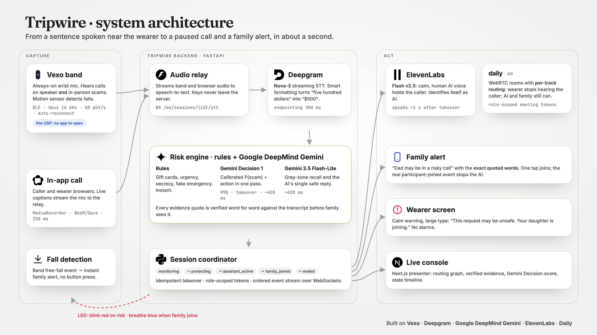

# Tripwire

**A pause when it matters.** Tripwire is an always-on guardian for older adults, built on the **Vexo band**. When someone pressures the wearer ("buy gift cards now, don't tell anyone"), Tripwire notices within about a second:
- it pauses the conversation, and an AI assistant that says it is an AI holds the caller;
- the wearer gets a calm warning;
- a trusted family member is alerted with the **exact words** that raised concern, and can join in one tap.

> Built for Vexo Hacks with **Vexo** · **Deepgram** · **Google DeepMind Gemini** · **ElevenLabs** · **Daily**.
> Why each one is essential, plus the demo scripts and answers to likely questions: [`docs/PITCH.md`](docs/PITCH.md).

## Architecture

## Dashboard

| Stage | What happens | Key files |
|---|---|---|
| **Capture** | The **Vexo band** streams its mic over BLE (Opus, 16 kHz, 50 packets/s) through the band bridge. The **in-app call** streams browser mic audio (MediaRecorder, WebM/Opus, 250 ms chunks) to the backend relay. A band free-fall event or SOS goes straight to a family alert. | `backend/band_bridge.py`, `backend/vendor/vexo_open/`, `frontend/app/_lib/useLiveTranscription.ts` |
| **Speech to text** | **Deepgram Nova-3** streaming, `endpointing=300`. API keys stay on the server. | `backend/stt.py` (`WS /ws/sessions/{id}/stt`) |
| **Risk engine** | Fixed rules (gift cards, urgency, secrecy, fake emergency, large amounts) run alongside **Gemini Decision 1**, which gives a calibrated P(scam). **Gemini** (`GEMINI_MODEL`) handles grey-zone cases and the AI's reply. Every evidence quote is checked word for word against the transcript. | `backend/intelligence/`, `backend/gemini_decision.py` |
| **Coordinator** | State machine, takeover that runs only once, role-scoped tokens, ordered WebSocket event stream. | `backend/app.py`, `backend/session.py`, `shared/COORDINATOR.md` |
| **Act** | **ElevenLabs Flash v2.5** speaks to the caller as an AI. **Daily** rooms route each audio track separately, so the wearer stops hearing the caller while the AI and family still can. The band LED blinks red on risk and breathes blue when family joins. | `backend/assistant_voice.py`, `backend/calls/`, `frontend/components/call/` |
| **Screens** | Wearer warning, caller view, family alert with one-tap join, live presenter console. | `frontend/app/` |

**State machine:** `monitoring → protecting → assistant_active → family_joined → ended`.
- Illegal transitions are rejected.
- Duplicate high-risk decisions never start a second takeover or alert.
- Takeover becomes active only after the wearer client confirms caller audio is blocked **and** the assistant is ready.

### How one scam call flows
1. **Audio in.** The caller speaks. The browser (or the band bridge) streams the audio to **Deepgram**, and each finished sentence becomes a `transcript.final` event.
2. **Detection.** The rules and Gemini Decision 1 score the sentence in parallel. Gemini is consulted for grey-zone cases.
3. **Takeover.** On **high + takeover**, the coordinator enters `protecting`, alerts family, and tells call control to reroute. On **Daily**, the wearer stops receiving the caller's audio while the AI and family still hear it. The band blinks red.
4. **AI holds the caller.** Once the wearer confirms the routing and the assistant is ready, the state becomes `assistant_active`. **ElevenLabs** speaks: *"I am Tripwire, an AI assistant. This conversation has been paused for family verification."* Then it gives at most two short live replies.
5. **Family joins.** The family page shows the verbatim quotes. The daughter taps **Join the call**, and her real participant-joined event moves the state to `family_joined` and stops the AI.
6. **Wrap-up.** The wearer is reconnected only when family explicitly chooses to. Ending the session wipes all state.

**In-person (ambient) mode:** the band hears, for example, a pushy mechanic. The same detection runs with `speaker=ambient` and sends a family alert. No takeover happens, because nobody can mute a person standing in the room.

## What is verified

Status as recorded by the team on 2026-11-14 (details in [`docs/LIVE_DEMO.md`](docs/LIVE_DEMO.md)):

| Capability | Status |
|---|---|
| Browser mic → Deepgram streaming → transcript | ✅ Live Chrome test: scam speech transcribed word for word |
| Rules + Gemini risk decision with verified quotes | ✅ High risk with multiple reasons; benign stays low; "$2,000" alone stays review |
| Takeover state machine, duplicate safety, new session after end | ✅ Unit tests (see below) + smoke test 23/23 |
| ElevenLabs AI opening line + live reply served to the caller | ✅ Live test |
| Family alert → one-tap join → AI stops → explicit reconnect | ✅ Live test |
| Daily rooms + role tokens | ✅ Create/delete room via API; browser call client in `frontend/components/call` |
| Vexo band mic → Deepgram → risk → family alert → LED red | ✅ Verified live on band 17 (in-person scenario) |
| Full call scenario | ✅ Live end-to-end harness in real Chrome (fake mic plays generated scam speech): **9/9 checks** |

Not yet done: the full scenario run three times in a row on camera, and the final video. See [`STATUS.md`](STATUS.md).

**Tests (backend):**

| Suite | Result |
|---|---|
| `pytest -q` (calls + coordinator, from `pytest.ini`) | 85 pass, 1 known failure in `backend/tests/test_voice_stt.py` (test-isolation issue, fix in progress) |
| `pytest backend/intelligence/tests` | 93 pass |
| `pytest backend/audio/tests` | 38 pass |

**Tests (frontend):** `npm test` runs 11 reducer and routing tests.

## Run it

Full setup, credentials and troubleshooting: **[`docs/setup.md`](docs/setup.md)**. All commands run from the repo root.

| Step | macOS / Linux | Windows (PowerShell) |
|---|---|---|
| 1. Backend deps | `make venv` | `python -m venv .venv; .venv\Scripts\pip install -r backend/requirements.txt` |
| 2. Band deps (only if using the band) | `.venv/bin/pip install bleak av` | `.venv\Scripts\pip install bleak av` |
| 3. Keys | `cp .env.example .env`, then add the DAILY / DEEPGRAM / GEMINI / ELEVENLABS keys | `Copy-Item .env.example .env` |
| 4. Verify keys (prints PASS/FAIL, never values) | `.venv/bin/python -m backend.audio.provider_checks.run_all` | `.venv\Scripts\python -m backend.audio.provider_checks.run_all` |
| 5. Backend on :8000 | `make backend` | `.venv\Scripts\python -m uvicorn backend.app:app --reload --port 8000` |
| 6. Frontend on :3000 | `cd frontend && npm install && npm run dev` | same |
| 7. Band (optional) | `./scripts_run_band.sh 17` (auto-restarts) or `.venv/bin/python -m backend.band_bridge --band 17 --follow` | `.venv\Scripts\python -m backend.band_bridge --band 17 --follow` |

- **Start a demo:** open http://localhost:3000, click **Start session**, then open the Presenter, Wearer, Caller and Family links.
- **Band bridge:** double-tap the band first (it blinks blue). With `--follow` it stays connected and attaches to every new session. Use `--sim` to test without the band.
- **Another device** (for example the daughter's phone): set `NEXT_PUBLIC_BACKEND_URL` for the frontend and `FRONTEND_ORIGIN` for the backend to reachable addresses.
- **Demo scripts:** [`docs/LIVE_DEMO.md`](docs/LIVE_DEMO.md), [`docs/RECORDING.md`](docs/RECORDING.md), [`demo/script.md`](demo/script.md).
- **Tests:** `make test` (backend), `cd frontend && npm test`, `make smoke` (needs a running backend).

## Repository map

| Path | What |
|---|---|
| `backend/app.py`, `backend/session.py` | Session coordinator: HTTP + WebSocket API, state machine, event stream |
| `backend/stt.py` | Deepgram streaming relay for browser audio |
| `backend/band_bridge.py`, `backend/vendor/vexo_open/` | Vexo band bridge (band mic → Deepgram → risk; LED, SOS, fall alerts) and the vendored Vexo Open kit (MIT) |
| `backend/gemini_decision.py` | Gemini Decision 1 scam probability |
| `backend/assistant_voice.py` | ElevenLabs assistant voice |
| `backend/intelligence/` | Risk rules, Gemini, evidence verification, intervention text |
| `backend/calls/`, `backend/calls_bridge.py` | Call control (Daily / mock), routing confirmation, family join |
| `backend/audio/` | Provider credential checks; laptop-mic / WAV-replay audio adapters (16 kHz mono PCM) for testing without the band |
| `frontend/app/`, `frontend/components/` | Launch page, presenter, wearer, caller and family screens; call components |
| `shared/` | API + event contract (`COORDINATOR.md`, `contracts.json`) |
| `fixtures/` | Scripted transcripts for the replay and detector tests |
| `docs/` | Setup, live demo, recording script, pitch, architecture diagram |

## Principles
- **Says it is an AI.** It never impersonates the wearer.
- **Never moves money**, never shares private details, never negotiates.
- **Family decides** when the wearer rejoins.
- **Honest UI:** replays are labelled "Demo replay", quotes are checked against the transcript, and failures are shown as failures.
- **Keys stay server-side:** only `NEXT_PUBLIC_BACKEND_URL` reaches the browser.

*Prototype. Calls through our app.*
